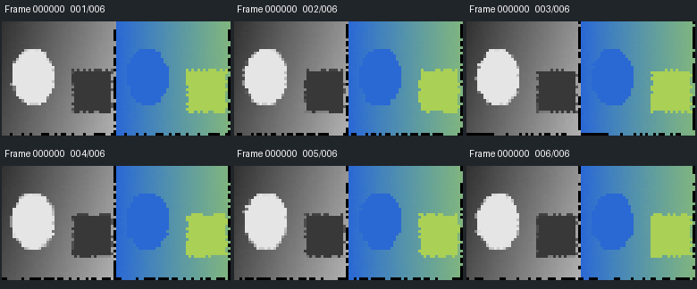

# My_code_12 · 可配置固定掩码的 DA 米制深度重建

输入一幅测量大图，输出同一坐标系的一幅米制深度图。主网络沿用 My_code_10 的 Depth Anything V2 metric 架构，包括 DINOv2 编码器、原有位置编码和 DPT 深度头。默认严格加载官方 Hypersim ViT-S 权重。坐标先验和整图整合默认均关闭，可以独立开启。

## 准备训练数据并运行

1. 安装适配设备的 PyTorch 和仓库依赖。在 `settings.py` 填写 `train_y`、`train_depth`、`val_y`、`val_depth`。同一场景的测量图与单通道深度 TIFF 使用同一文件名主干，二者须已配准。深度单位是米时用 `depth_scale=1`，毫米时用 `0.001`。
2. 运行 `python prepare_dataset.py`。训练测量按 `expected_hw` 双线性缩放，深度按最近邻缩放；尺寸相同直接使用，设为 `None` 可保留原始网格。RGB/RGBA 使用原辐射配置转为灰度。生成目录默认是 `data/prepared_12`，每幅训练图保存一个 NPZ，并在全部成功后更新清单。My_code_10 的规则相位缓存需要从原图重新生成。
3. 把官方室内米制权重路径填入 `da_weights`，从仓库根目录运行 `python train.py`。训练入口要求权重参数名和形状完全匹配。每步使用同一幅图的全部子图；`batch_size` 控制单次 DA 前向的子图数，整帧回填后计算米制 L1 和可选的邻接梯度损失。显存紧张时可设 `batch_size=1`、`checkpoint_da_activations=True`，后者在反传时重算前向。模型选择及权重哈希见[官方权重来源](da_vendor/PROVENANCE.md)。
4. 每轮直接从 `val_y`、`val_depth` 读取测试大图，对测量与配准深度作相同中心裁剪，在裁剪网格采样、重建和回填。实拍时在 `reconstruct_real.py` 填训练产生的 `CHECKPOINT`，在 `settings.py` 填 `real_dir`，运行 `python reconstruct_real.py` 即可。独立测试入口是 `python evaluate.py`，共用同一 `CHECKPOINT`。实拍和测试从权重恢复模型开关、掩码版本和种子，默认逐张子图前向。每轮实拍可设 `real_each_epoch=True`。

## 先生成数据集并检查子图

在 `settings.py` 中，`expected_hw` 和 `center_crop_hw` 均按 **[高, 宽]** 填写，`phase_grid_xy=[a,b]` 按 **[横向数, 纵向数]** 填写。例如：

```python
expected_hw = [1536, 2500]
center_crop_hw = [1036, 2072]
phase_grid_xy = [4, 2]
```

训练先 resize，再取中心 1036×2072，起点为零基 [250,214]。在每个 **b 行 × a 列**的单元内做固定随机分配，得到 a×b 张互补交织子图。以上设置产生 8 张 518×518 子图；改成 [3,2] 后，同一裁剪产生 6 张 518×691 子图。每个真实像素恰好出现一次；边缘空槽坐标为 [-1,-1]。默认布局保留以前的固定表，其他布局按种子、横纵数和单元行确定 PCG64 排列。修改布局、种子或裁剪尺寸后，重新运行 `python prepare_dataset.py`。[采样实现](sampling.py)

每张大图生成一个 NPZ 和一个同名预览目录。`crop.png` 显示裁剪后的测量与真值深度；`index.png` 汇总该帧全部子图；`part_001.png` 等文件单独保存每张带帧号及序号的子图，左侧测量、右侧深度。编号从 1 开始，第 k 张 PNG 对应 NPZ 第 k−1 项。预览标注只写到 PNG。清单记录预览路径、原始尺寸、缩放尺寸、裁剪起点及裁剪尺寸。

| NPZ 字段 | 形状 | 含义 |
|---|---|---|
| `y`、`depth`、`valid` | [a×b, ceil(H/b), ceil(W/a)] | 同一点的测量、米制深度和有效性，H、W 为裁剪后的高宽 |
| `coords_yx` | [a×b, ceil(H/b), ceil(W/a), 2] | 裁剪网格的零基 [行,列]。有效坐标加上清单的 `crop_origin_yx` 即得缩放网格坐标 |

测试和实拍默认直接从原始大图中心截取 `center_crop_hw`，再按训练记录的布局逐张重建并拼回**裁剪尺寸**保存。如需与训练一致地先缩放再中心裁剪，在训练配置设 `resize_before_inference_crop=True`。原图小于指定裁剪时会报告尺寸；设 `center_crop_hw=None` 则保留当前网格全幅。旧 checkpoint 按原来的全幅八掩码方式重建。

### 已生成的六子图示例

下面是一对合成测量与深度标签，通过正式预处理入口从 93×131 缩放至 100×160，中心取 81×121，按 [3,2] 生成 6 张 41×41 子图。目录中包含原始测量、深度 TIFF、训练 NPZ、裁剪预览与全部带编号子图。[示例数据与清单](examples/synthetic_grid_3x2/prepared/manifest.json)



## 两个独立模型开关

| `use_coordinate_prior` | `use_refiner` | 运行路径 |
|---|---|---|
| False | False | 官方预训练 DA 逐子图预测，按坐标回填即输出 |
| True | False | DA patch token 加入整图坐标编码，回填即输出 |
| False | True | DA 回填后，用整图测量与粗深度预测深度残差 |
| True | True | 同时使用坐标编码和整图残差修正 |

开启先验时，每个采样点的真实行、列按该帧高宽分别归一化至 [−1,1]。一个核大小和步长均为 14 的可训练线性卷积将该 DA patch 内所有采样坐标投影到 token 维度，与图像 patch embedding 相加，再经过原有 DINOv2 位置编码和 Transformer。坐标投影零初始化，初始深度与同权重的 DA 基线一致。整合器是三层 3×3 卷积，末层零初始化，输出为粗深度加残差。可用 `freeze_da=True` 只训练已开启的附加模块；两个开关都关闭时须允许至少深度头训练。[模型实现](model.py)

## 结果与验证范围

训练预览保存回填后的整图。测试和实拍导出 PNG、米制 TIFF 及 NPZ。每轮测试目录有 `metrics.json` 和 `depth_bins.png`。按真值每 0.1 m 分箱，报告每箱有效像素比例和箱内 `abs(pred−gt)/gt ≤ 0.03` 的比例，总体指标按有效像素汇总。实验对照可固定数据、权重和种子，分别训练上表四种配置。

运行 `python -m unittest discover` 可检验掩码覆盖、坐标回填和反传、开关的初始化等价性，并用临时图像完成一轮 ViT-S 训练、中心裁剪测试和实拍回放。集成测试使用随机初始化的同构 DA 权重文件。当前工作区未提供此次更换的原始配对数据和官方权重，因此已生成并验证默认固定掩码表；实际训练集 NPZ 需在数据所在机器运行预处理，实际深度精度需用该数据衡量。
